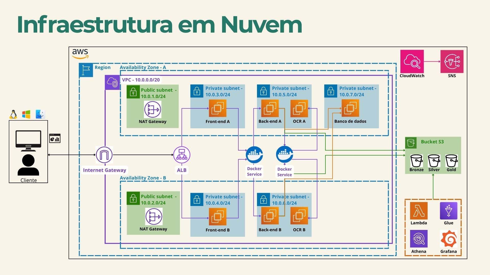
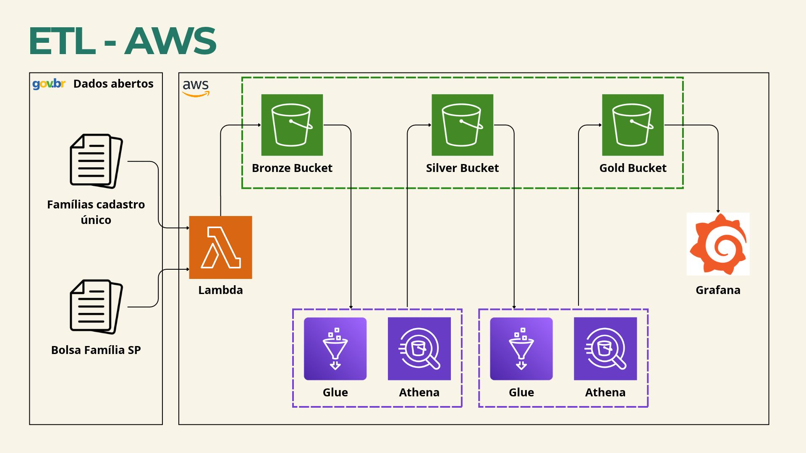

# ☁️ Família Connect — Infraestrutura AWS (Terraform)

> Infraestrutura como código do sistema Família Connect: aplicação em Docker Swarm sobre EC2 em duas Availability Zones, mais um pipeline de dados (S3 bronze/silver/gold, Lambda, Glue e Athena) e monitoramento com CloudWatch e SNS.

---

## 📋 Sobre o Projeto

Este repositório provisiona na AWS, com Terraform, tudo o que o **Família Connect** precisa para rodar:

- **Aplicação:** Front, Back, OCR, RabbitMQ, Redis, Grafana e o serviço `processar-carteirinhas`, executados como uma stack de **Docker Swarm** em 7 instâncias EC2, atrás de um único ALB público.
- **Dados:** camadas **bronze → silver → gold** no S3, com ingestão por Lambda, tratamento por job Glue (PySpark) e consulta pelo Athena.
- **Observabilidade:** alarmes e dashboard no CloudWatch, com notificação por e-mail via SNS.

---

## 🗺️ Diagrama da Infraestrutura



> Há um único ALB (o do Front): o balanceamento de Back e OCR é feito pelo próprio Docker Swarm (VIP + IPVS), representado no diagrama pelos ícones *Docker Service*.

---

## 🏗️ Visão Geral da Arquitetura

VPC `10.0.0.0/20`, distribuída em duas Availability Zones:

| Camada | AZ A | AZ B | Conteúdo |
|---|---|---|---|
| Pública | `10.0.1.0/24` | `10.0.2.0/24` | ALB Front + NAT Gateways |
| Front privada | `10.0.3.0/24` | `10.0.4.0/24` | Front A (`10.0.3.10`) e Front B (`10.0.4.10`) |
| Back privada | `10.0.5.0/24` | `10.0.6.0/24` | Back A (`10.0.5.10`) / OCR A (`10.0.5.20`) e Back B (`10.0.6.10`) / OCR B (`10.0.6.20`) |
| Banco | `10.0.7.0/24` | — | MySQL (`10.0.7.10`) |

### Instâncias EC2 (7)

| Instância | Hostname | Tipo | Papel |
|---|---|---|---|
| Front A / B | `fc-front-a` / `fc-front-b` | `t3.micro` | Swarm **managers** |
| Back A / B | `fc-back-a` / `fc-back-b` | `t3.medium` (`back_instance_type`) | Swarm workers (`fc_role=back`) |
| OCR A / B | `fc-ocr-a` / `fc-ocr-b` | `t3.micro` | Swarm workers (`fc_role=ocr`) |
| Banco | `ec2-db` | `t3.micro` | MySQL fora do Swarm |

Nenhuma instância tem IP público. Os únicos Elastic IPs são os dos dois NAT Gateways.

### Fluxo de comunicação

```text
Cliente
  │
  ▼
ALB Front (público :80)
  │
  ▼
Front A/B (managers, :80)
  │   Nginx: "/api" → http://back:8080 ; "/grafana/" → http://grafana:3000
  │   (rede overlay Swarm "fc-overlay" — VIP + IPVS)
  ▼
Back A/B (:8080)
  ├──► Banco de dados MySQL (10.0.7.10:3306)
  ├──► OCR A/B (http://ocr:8000, pela overlay)
  ├──► RabbitMQ (rabbitmq:5672) ◄──► processar-carteirinhas
  ├──► Redis (redis:6379)
  └──► S3 gold (armazenamento de arquivos, quando APP_STORAGE_TYPE=s3)
```

O navegador usa `API_BASE_URL=/api`; o Nginx do container Front encaminha `/api/*` para o serviço `back`. O Back acessa o OCR, o RabbitMQ e o Redis pelo nome do serviço na overlay. Não há ALB para Back/OCR.

### Roteamento

- **Sub-redes públicas:** `0.0.0.0/0` → Internet Gateway.
- **Sub-redes privadas da AZ A:** `0.0.0.0/0` → NAT Gateway A.
- **Sub-redes privadas da AZ B:** `0.0.0.0/0` → NAT Gateway B.

---

## 🛠️ Serviços AWS Utilizados

| Serviço | Finalidade |
|---|---|
| **VPC** | Rede isolada `10.0.0.0/20`, 7 sub-redes |
| **EC2** | 7 instâncias (2 Front, 2 Back, 2 OCR, 1 Banco) |
| **Internet Gateway / NAT Gateway** | Acesso público e saída das sub-redes privadas (2 NATs, um por AZ) |
| **Application Load Balancer** | Um ALB público (`lb-front`), listener HTTP `:80` |
| **ACL de Rede / Security Groups** | Controle de tráfego por camada e por instância |
| **S3** | Buckets Bronze, Silver e Gold (criados via provider `awscc`) |
| **Lambda + EventBridge** | Ingestão mensal das bases para o bronze |
| **Glue** | Job PySpark bronze → silver, crawler e Data Catalog |
| **Athena** | Workgroup para consulta ao silver |
| **CloudWatch** | Alarmes (CPU, rede, disco, S3) e dashboard |
| **SNS** | Notificação dos alarmes por e-mail |
| **SSM Parameter Store** | Chave SSH privada e tokens do Docker Swarm |

---

## 📁 Estrutura do Repositório

```text
Familia-Connect-Infra/
├── main.tf                    # Orquestra rede, EC2, ALB, S3 e monitoramento; define a stack do Swarm
├── ingestao.tf                # Módulo da Lambda de ingestão + variáveis e outputs
├── glue.tf                    # Módulo do job Glue (bronze → silver) + crawler
├── athena.tf                  # Módulo do workgroup Athena
├── variables.tf               # Variáveis de entrada
├── outputs.tf                 # Outputs da infraestrutura
├── providers.tf               # Providers: aws, awscc, tls, archive
├── terraform.tfvars.example   # Exemplo de valores (copiar para terraform.tfvars)
├── scripts/
│   ├── config_front.sh.tftpl  # User-data do Front: SFTP restrito, Docker, init do Swarm e deploy da stack
│   ├── config_back.sh.tftpl   # User-data do Back: Docker + entrada no Swarm como worker
│   ├── config_ocr.sh.tftpl    # User-data do OCR: Docker + entrada no Swarm como worker
│   ├── config_db.sh.tftpl     # User-data do Banco: MySQL + schema do repositório Familia-Connect-BD
│   └── swarm-stack.yml.tftpl  # Stack do Swarm (front, back, grafana, rabbitmq, redis, ocr, processar-carteirinhas)
├── lambda/ingestao/           # Código Python da Lambda de ingestão
├── glue/transformacao/        # Script PySpark do job bronze → silver
├── modules/
│   ├── network/               # VPC, sub-redes, IGW, NATs, route tables, NACLs
│   ├── keypair/               # Par de chaves TLS + chave privada no SSM
│   ├── security/              # Security Groups
│   ├── compute/               # Instâncias EC2
│   ├── loadbalancer/          # ALB Front
│   ├── storage/               # Buckets S3 (bronze, silver, gold)
│   ├── monitoring/            # Alarmes CloudWatch, dashboard e tópico SNS
│   ├── ingestao/              # Lambda + agendamento EventBridge
│   ├── glue/                  # Job, triggers, Data Catalog e crawler
│   └── athena/                # Workgroup do Athena
└── diagrama-infraestrutura.jpg
```

---

## 🐳 Docker Swarm

O cluster é montado automaticamente pelos scripts de user-data:

| Instância | Papel Swarm | Hostname |
|---|---|---|
| Front A | Manager (inicia o cluster) | `fc-front-a` |
| Front B | Manager | `fc-front-b` |
| Back A / B | Worker | `fc-back-a` / `fc-back-b` |
| OCR A / B | Worker | `fc-ocr-a` / `fc-ocr-b` |

O Front A executa `docker swarm init` e grava os tokens de manager e de worker no SSM Parameter Store (`/familia-connect/swarm/manager-token` e `/familia-connect/swarm/worker-token`). Os demais nós leem o token de lá para entrar no cluster, sem deixar segredos fixos no Terraform. O `LabInstanceProfile` precisa permitir `ssm:GetParameter` e `ssm:PutParameter`.

### Ordem de subida da stack

1. O Front A espera o ALB (`lb-front`) existir e descobre o DNS dele em tempo de execução.
2. Espera os quatro workers entrarem no cluster e aplica os labels `fc_role=back` (Back A/B) e `fc_role=ocr` (OCR A/B).
3. **Fase 1:** publica a stack com o `back` em 0 réplicas, para RabbitMQ e Redis subirem primeiro (o Swarm não tem `depends_on`).
4. **Fase 2:** quando `rabbitmq` e `redis` estão com `1/1` réplicas, o `back` é escalado para 2 e a stack é publicada de novo.

### Serviços da stack

| Serviço | Imagem | Réplicas | Onde roda |
|---|---|---|---|
| `front` | `fsfernando072/familia-connect-front` | 2 | Managers (1 por nó); publica `:80` em `mode: host` |
| `back` | `fsfernando072/familia-connect-back` | 2 | Workers `fc_role=back` (1 por nó) |
| `grafana` | `fsfernando072/familia-connect-grafana` | 1 | Manager |
| `rabbitmq` | `rabbitmq:4-management` | 1 | Fixado em `fc-back-a` (volume local `rabbitmq_data`) |
| `redis` | `redis:7-alpine` | 1 | Worker `fc_role=back` |
| `ocr` | `fsfernando072/familia-connect-ocr` | 2 | Workers `fc_role=ocr` (1 por nó) |
| `processar-carteirinhas` | `processar_carteirinhas_image` | 1 | Worker `fc_role=back` |

Todos usam a rede overlay `fc-overlay` e se encontram pelo nome do serviço (`endpoint_mode: vip`). Só o Front publica porta para o ALB; Back, OCR e Redis não publicam portas.

- **Grafana:** sem porta publicada. O Front o expõe em `/grafana/` (proxy do Nginx, só para quem está logado) e a tela Dashboard o embute por iframe. Ele consulta o back em `host.docker.internal:8080`, que a stack cria como *alias* do serviço `back` na overlay. Dashboards e datasource vêm embutidos na imagem; para alterá-los, publique uma nova versão da imagem. Variáveis: `grafana_api_token` (o mesmo valor vai para Back e Grafana) e `grafana_admin_password`.
- **RabbitMQ:** o Back o acessa por `rabbitmq:5672`. As portas `5672` (AMQP) e `15672` (painel) são publicadas em `mode: host` em `fc-back-a` e liberadas no `back-sg` apenas para a VPC. Como o nó é privado, o painel é acessado por túnel SSH (`ssh -L 15672:localhost:15672 ...`). Credenciais em `rabbitmq_username` e `rabbitmq_password`.
- **processar-carteirinhas:** consome a fila do RabbitMQ, acessa o MySQL e grava no bucket S3 gold. A imagem vem da variável `processar_carteirinhas_image`.

Portas internas necessárias para o Swarm (liberadas para a VPC nos Security Groups e NACLs):

- TCP `2377`: gerenciamento do cluster
- TCP/UDP `7946`: comunicação entre nós
- UDP `4789`: rede overlay (VXLAN)

Como o tráfego de aplicação passa pela overlay, as portas `8080`/`8000` não precisam estar abertas nos Security Groups.

---

## 📤 SFTP restrito (nos Fronts)

Implementa o roteiro *SFTP Restrito* **nos managers do Swarm** (`fc-front-a` / `fc-front-b`), para enviar arquivos (por exemplo, o `swarm-stack.yml`) direto a quem orquestra o cluster. O bloco está em `scripts/config_front.sh.tftpl` (função `configure_sftp`); se falhar, o bootstrap do Swarm segue normalmente.

| Item | Valor |
|---|---|
| Usuário SFTP | `familia_sftp` (variável `sftp_username`) |
| Raiz do chroot (dono `root`, 755) | `/srv/familia-connect` |
| Pasta gravável | `/srv/familia-connect/data` (vista como `/data` no SFTP) |
| Chaves autorizadas | `/etc/ssh/keys/familia_sftp/authorized_keys` |
| Regras no `sshd_config` | `ForceCommand internal-sftp`, `ChrootDirectory`, sem TTY e sem forward, só chave pública (validado com `sshd -t` antes do restart) |

Os Fronts ficam em sub-rede privada, sem IP público e sem bastion. O acesso é feito pelo **AWS Systems Manager Session Manager**: ele abre um túnel até a porta 22 da instância e o SFTP trafega dentro dele. Não é preciso host de salto nem liberar a 22 na rede, porque o SSM Agent conecta ao `sshd` local da própria instância.

**Requisitos na sua máquina**

- AWS CLI v2 configurada com credenciais que possam usar `ssm:StartSession` na instância e no documento `AWS-StartSSHSession`.
- [Session Manager plugin](https://docs.aws.amazon.com/systems-manager/latest/userguide/session-manager-working-with-install-plugin.html) instalado (`session-manager-plugin --version` para conferir).
- Instância com SSM Agent online (a mesma condição para abrir uma sessão normal no console).

**Uso**

```bash
# 1. Chave do SFTP (cole o .pub em sftp_public_key no terraform.tfvars ANTES do apply)
ssh-keygen -t ed25519 -f ~/.ssh/familiasftp -C "familia-connect-sftp-key"
cat ~/.ssh/familiasftp.pub

# 2. ID da instância do Front A (ou instance_front_b_id para o Front B)
terraform output -raw instance_front_a_id     # ex.: i-0123456789abcdef0

# 3. Conexão direta, sem editar nenhum arquivo
sftp -i ~/.ssh/familiasftp \
  -o ProxyCommand="aws ssm start-session --target %h --document-name AWS-StartSSHSession --parameters portNumber=%p" \
  familia_sftp@i-0123456789abcdef0
sftp> cd data
sftp> put swarm-stack.yml
```

**Atalho em `~/.ssh/config`** (no Windows, `C:\Users\<usuario>\.ssh\config`; depois `chmod 600 ~/.ssh/config` no Linux/macOS e `sftp familia_sftp`):

```text
Host familia_sftp
    HostName i-0123456789abcdef0
    User familia_sftp
    IdentityFile ~/.ssh/familiasftp
    IdentitiesOnly yes
    ProxyCommand aws ssm start-session --target %h --document-name AWS-StartSSHSession --parameters portNumber=%p
```

Se usar outra região ou perfil da AWS CLI, acrescente `--region <regiao>` e/ou `--profile <perfil>` ao comando do `ProxyCommand`. O `HostName` precisa ser atualizado se a instância for recriada, pois o ID muda.

**Alternativa: redirecionamento de porta** (útil para WinSCP, FileZilla e outros clientes gráficos):

```bash
# Terminal 1: deixa o túnel aberto (porta local 2222 → porta 22 do Front A)
aws ssm start-session --target i-0123456789abcdef0 \
  --document-name AWS-StartPortForwardingSession \
  --parameters '{"portNumber":["22"],"localPortNumber":["2222"]}'

# Terminal 2
sftp -P 2222 -i ~/.ssh/familiasftp familia_sftp@localhost
```

Se a instância for recriada, o cliente pode reclamar da chave do host em `localhost:2222`; limpe com `ssh-keygen -R "[localhost]:2222"`.

A chave administrativa (`myssh.pem`, no SSM em `key_pair_ssm_parameter`) **não é necessária para o SFTP**; ela só serve para entrar por SSH como `ubuntu`. Cada Front tem seu próprio disco: os arquivos enviados ao Front A não aparecem no Front B.

Teste de bloqueio de shell: `ssh familia_sftp` deve responder *"This service allows sftp connections only."*

> ⚠️ Os arquivos ficam no disco do Front. Trocar `sftp_public_key` (ou qualquer conteúdo do `user_data` do Front) **recria a instância**, inclusive o manager do Swarm.

---

## 🗄️ Pipeline de dados (S3 + Lambda + Glue + Athena)



```text
Fontes públicas ──► Lambda de ingestão ──► S3 bronze (CSV)
                                              │
                                  Glue job bronze → silver
                                              ▼
                       S3 silver (Parquet, partição por ano)
                                              │
                         Crawler → Data Catalog → Athena
```

Os três buckets (`bronze`, `silver`, `gold`) são criados pelo módulo `storage`. O gold é usado pelo Back e pelo `processar-carteirinhas` como armazenamento de arquivos (`APP_STORAGE_S3_BUCKET`). A Lambda e o Glue usam a role existente `LabRole` (variável `lambda_role_name`).

### Ingestão (Lambda)

Módulo `modules/ingestao` + `ingestao.tf`; código em `lambda/ingestao/lambda_function.py` (Python 3.12, timeout 900 s, 512 MB). Baixa duas bases e grava no bucket bronze:

| Base | Fonte | Chave no bronze |
|---|---|---|
| Famílias do Cadastro Único | API MDS/SAGI | `familias-cadastro-unico/{ano}/familias-cadastro-unico-{ano}.csv` |
| Bolsa Família SP | Página da Prefeitura de SP | `bolsa-familia-sp/{ano}/bolsa-familia-sp-{ano}.csv` |

- **Agendamento:** EventBridge, dia 1 de cada mês às 06:00 UTC, processando somente o ano atual.
- **Carga histórica:** `ingestao_ano_inicial` (padrão `2020`) até `ingestao_ano_final` (padrão `2026`). Com `ingestao_executar_no_apply = true`, a carga roda durante o `terraform apply` (pode levar vários minutos).
- **Execução manual:** o output `lambda_ingestao_invoke_cmd` traz o comando `aws lambda invoke ...`.

### Tratamento bronze → silver (Glue)

Módulo `modules/glue` + `glue.tf`; código PySpark em `glue/transformacao/transformacao_silver.py`. O job `familia-connect-bronze-para-silver` (Glue 4.0, 2 workers `G.1X`, timeout de 60 min) lê os CSVs do bronze, trata os dados e grava Parquet no silver. Está agendado para o dia 1 às 07:00 UTC, uma hora depois da ingestão. O script é publicado em `s3://<silver>/glue-scripts/`.

| Base | Saída no silver | Tratamentos |
|---|---|---|
| familias-cadastro-unico | `cadunico/ano=AAAA/` | Leitura por nome de coluna, vazio/"null"/"NaN" → NULL, contagens nulas → 0, taxas nulas mantidas, `anomes_s` → ano/mes/ano_mes, descarte de inválidos, dedupe por município+mês |
| bolsa-familia-sp | `bolsa-familia-sp/ano=AAAA/` | Detecta encoding e separador por arquivo, harmoniza layouts (2 e 4 colunas), remove ponto de milhar, padroniza nome do distrito, descarta totais, dedupe por ano+distrito |

Ao terminar com sucesso, uma trigger condicional dispara o crawler `familia-connect-silver-crawler`, que cataloga os Parquets no banco `familia_connect_silver` do Data Catalog (tabelas `cadunico` e `bolsa_familia_sp`).

Execução manual: `aws glue start-job-run --job-name familia-connect-bronze-para-silver` (ver output `glue_job_run_cmd`).

### Consulta ao silver (Athena)

Módulo `modules/athena` + `athena.tf`. Cria o workgroup `familia-connect-silver` (engine v3, limite de 10 GB lidos por consulta, resultados criptografados com SSE-S3), que consulta o banco `familia_connect_silver`.

| Item | Valor |
|---|---|
| Tabelas | `cadunico` e `bolsa_familia_sp` (particionadas por `ano`) |
| Resultado das consultas | `s3://<silver>/athena-results/` |
| Exports diretos (UNLOAD / CTAS) | `s3://<silver>/export/` |

Uso: `terraform apply` → rodar a ingestão → rodar o job do Glue (o crawler dispara sozinho ao final) → no console do Athena, selecionar o workgroup `familia-connect-silver` e o banco `familia_connect_silver`. O módulo só configura o workgroup: não cria consultas salvas nem grava objetos no bucket; as pastas `athena-results/` e `export/` aparecem quando a primeira consulta ou export gravar nelas. O destino de um `UNLOAD` precisa estar vazio: use uma subpasta nova de `export/` a cada execução.

> O diagrama ETL prevê uma segunda etapa Glue + Athena (silver → gold) alimentando o Grafana. Essa etapa **ainda não está neste repositório**: o bucket gold (`familia-connect-gold-g02`) é provisionado, mas nenhum job o popula com dados analíticos; hoje ele guarda os arquivos da aplicação.

---

## 📊 Monitoramento

O CloudWatch Dashboard `familia-connect-dashboard` mostra CPU das 7 instâncias, rede dos Fronts, disco do Banco e tamanho dos buckets. Alarmes configurados:

| Alarme | Regra |
|---|---|
| CPU (todas as 7 instâncias) | Média > 80% por 2 períodos de 5 min |
| NetworkIn / NetworkOut (Fronts) | Soma > 100 MB por 2 períodos de 5 min |
| Disco do Banco (`disk_used_percent`) | > 85% por 2 períodos de 5 min — **exige CloudWatch Agent na instância** (métrica do namespace `CWAgent`) |
| Tamanho dos buckets S3 | > 5 GB (período de 1 dia) |

Todos notificam o tópico SNS `familia-connect-cloudwatch-alerts`, com inscrição por e-mail para cada endereço de `alert_emails`. Cada destinatário precisa **confirmar a inscrição** no e-mail que a AWS envia.

---

## ⚙️ Pré-requisitos

- [Terraform](https://www.terraform.io/downloads.html) >= 1.5.0
- [AWS CLI](https://aws.amazon.com/cli/) instalado e configurado (`aws configure`)
- Permissões para criar VPC, EC2, ELB, S3, Lambda, Glue, Athena, CloudWatch, SNS, EventBridge e SSM
- **IAM Instance Profile** `LabInstanceProfile` existente na conta (S3, SSM e `elasticloadbalancing:DescribeLoadBalancers` para os user-data)
- **IAM Role** `LabRole` existente na conta (usada pela Lambda e pelo Glue)
- Imagens Docker publicadas no Docker Hub (Front, Back, OCR, Grafana e `processar-carteirinhas`)

---

## 🚀 Como Provisionar a Infraestrutura

### 1. Clone o repositório

```bash
git clone https://github.com/fsFernando072/Familia-Connect-Infra.git
cd Familia-Connect-Infra
```

### 2. Configure as variáveis

```bash
cp terraform.tfvars.example terraform.tfvars
```

Edite `terraform.tfvars` (o arquivo é ignorado pelo git via `.gitignore`). As variáveis abaixo **não têm default** e são obrigatórias; também podem vir de `TF_VAR_<nome>`:

| Variável | Uso |
|---|---|
| `ocr_space_api_key` | API key do OCR.space (serviço `ocr`) |
| `db_username` / `db_password` | Usuário e senha do MySQL, criados no Banco e usados pelo Back |
| `jwt_secret` | Chave de assinatura dos tokens JWT do Back (mínimo 32 caracteres) |
| `grafana_api_token` | Segredo compartilhado entre Back e Grafana |
| `grafana_admin_password` | Senha do admin do Grafana |
| `rabbitmq_password` | Senha do RabbitMQ (sem default) |
| `sftp_public_key` | Chave **pública** autorizada no SFTP dos Fronts |

Outras variáveis úteis (todas com default em `variables.tf`):

| Variável | Padrão | Observação |
|---|---|---|
| `aws_region` | `us-east-1` | |
| `ami_id` | `ami-0c7217cdde317cfec` | Ubuntu 22.04 x86 (`us-east-1`); troque se mudar de região |
| `instance_type` / `back_instance_type` | `t3.micro` / `t3.medium` | |
| `iam_instance_profile_name` | `LabInstanceProfile` | |
| `s3_bronze_bucket_name`, `s3_silver_bucket_name`, `s3_gold_bucket_name` | `familia-connect-*-g02` | Nomes de bucket são globais: ajuste se já estiverem em uso |
| `alert_emails` | lista da equipe | Destinatários dos alarmes |
| `db_type_ddl` | `update` | Estratégia do Hibernate (`DB_TYPE_DDL`) |
| `app_storage_type` | `s3` | `s3` ou `local` |
| `rabbitmq_username`, `rabbitmq_exchange`, `rabbitmq_binding`, `rabbitmq_queue`, `rabbitmq_queue_resposta`, `rabbitmq_routing_resposta` | ver `variables.tf` | Usuário, exchange, binding, filas e routing key |
| `processar_carteirinhas_image` | `miguelramoslima/familia-connect:latest` | |
| `lambda_role_name` | `LabRole` | Role da Lambda e do Glue |
| `ingestao_ano_inicial` / `ingestao_ano_final` | `2020` / `2026` | |
| `ingestao_executar_no_apply` | `false` | Roda a carga durante o `apply` |

### 3. Inicialize, planeje e aplique

```bash
terraform init
terraform plan
terraform apply
```

(`terraform.tfvars` é lido automaticamente. Para outro arquivo, use `-var-file=<arquivo>`.)

Os Fronts, Backs, OCRs e o Banco instalam e configuram tudo por user-data **depois** do `apply`. A stack completa leva alguns minutos para ficar de pé: acompanhe pelos serviços do Swarm (`docker service ls` no Front A) e pelo ALB.

### 4. Acesse e carregue os dados

- URL da aplicação: output `lb_front_dns_name`.
- Carga de dados: execute a Lambda de ingestão e depois o job do Glue (comandos nos outputs `lambda_ingestao_invoke_cmd` e `glue_job_run_cmd`), ou aguarde o agendamento mensal.

### Principais outputs

`lb_front_dns_name`, `key_pair_ssm_parameter`, `db_private_ip`, `swarm_manager_ip`, `sftp_target_ip`, `s3_bronze_bucket` / `s3_silver_bucket` / `s3_gold_bucket`, `alerts_topic_arn`, `lambda_ingestao_invoke_cmd`, `glue_job_run_cmd`, `glue_crawler_run_cmd`, `athena_workgroup`, `athena_query_cmd`.

---

## 🗑️ Como Destruir a Infraestrutura

```bash
terraform destroy
```

> ⚠️ **Atenção:** a operação é irreversível. Os dados das instâncias (inclusive o banco MySQL e o volume do RabbitMQ) serão perdidos. Buckets S3 com objetos podem impedir a remoção: esvazie-os antes se o `destroy` falhar.

---

## 🔒 Regras de Segurança

### Security Groups

| SG | Porta | Origem | Finalidade |
|---|---|---|---|
| front-alb-sg | 80 | `0.0.0.0/0` | HTTP da internet |
| front-alb-sg | 443 | `0.0.0.0/0` | Aberta no SG, mas o ALB só tem listener HTTP `:80` |
| front-sg | 80 | front-alb-sg | ALB → Front |
| front-sg | 22 | `0.0.0.0/0` | Administração (as instâncias são privadas; a NACL do Front só aceita a 22 da VPC) |
| front-sg | 2377/TCP, 7946/TCP+UDP, 4789/UDP | VPC | Docker Swarm |
| back-sg | 22 | `0.0.0.0/0` | Administração |
| back-sg | 5672/TCP | VPC | RabbitMQ (AMQP) |
| back-sg | 15672/TCP | VPC | RabbitMQ (painel) |
| back-sg | 2377/TCP, 7946/TCP+UDP, 4789/UDP | VPC | Docker Swarm |
| ocr-sg | 22 | `0.0.0.0/0` | Administração |
| ocr-sg | 2377/TCP, 7946/TCP+UDP, 4789/UDP | VPC | Docker Swarm |
| db-sg | 3306 | back-sg | MySQL a partir do Back |
| db-sg | 22 | `0.0.0.0/0` | Administração |

Os Security Groups de Back, OCR e Banco aceitam a porta 22 de qualquer origem, mas as instâncias não têm IP público.

### Network ACLs

NACLs separadas para as sub-redes pública, front, back e banco, com portas efêmeras `1024-65535` liberadas e saída irrestrita. As regras de entrada principais são: pública `80/443/22`; front `80`, `8080`, `22` (VPC) e Swarm; back `8080`, `8000` e Swarm; banco `3306`.

---

## ⚠️ Observações Importantes

- **Sem CI/CD:** `terraform apply` roda manualmente.
- **State** não é commitado (`.gitignore` exclui `*.tfstate*`) e é **local**: não há backend remoto configurado.
- **Segredos:** `*.tfvars` está no `.gitignore`. Os valores também são embutidos no `user_data` das instâncias, então ficam visíveis no state e nos metadados das EC2. Nunca commite `terraform.tfvars`.
- **Defaults:** `rabbitmq_username` tem valor padrão em `variables.tf`; sobrescreva-o no `terraform.tfvars` se preferir outro.
- **Chave SSH privada** fica no SSM Parameter Store (output `key_pair_ssm_parameter`).
- **Banco:** o usuário da aplicação recebe `ALL PRIVILEGES ON *.* WITH GRANT OPTION` e o MySQL escuta em `0.0.0.0`; o acesso é restrito pelo `db-sg` (só o Back na `3306`). O schema vem do repositório público `Familia-Connect-BD`, clonado em tempo de boot via NAT.
- **Imagens `:latest`:** a stack usa tags `latest` do Docker Hub. Um novo `docker stack deploy` pode trazer versões diferentes.
- **Troca de `user_data` recria a instância** (`user_data_replace_on_change = true`). Isso vale para qualquer variável usada nos scripts, inclusive a stack do Swarm e os segredos, e para o Front inclui o manager do cluster.
- **Dependência do ALB:** o Front A só publica a stack depois de encontrar o ALB `lb-front`; se o ALB não existir, o bootstrap fica aguardando.
- **Disco do Banco:** o alarme depende de CloudWatch Agent, que nenhum script instala hoje.

---

## 📄 Licença

Este projeto está sob a licença MIT.